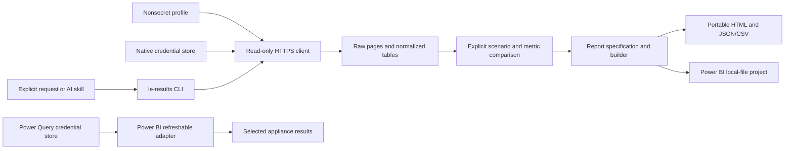

# Architecture and adoption

The engine is a small installable Python package. Its CLI turns explicit selection/configuration files into captures and comparisons. The API adapter owns routing, allowlisted operations and contract differences. Profiles and native vault lookup belong to the client process; data/report code never needs a token parameter. PowerShell and AI hosts invoke real CLI commands instead of reimplementing calculations.

This avoids maintaining separate PowerShell, Python and prompt-based statistics. httpx supplies trusted HTTPS transport; keyring supplies native vault integration; platformdirs supplies platform configuration paths. The standard library handles CLI parsing, serialization, hashing and arithmetic. There is no daemon, web service, database or required C# component. Dependency locks support reproducible pip installation.

The cost of a deterministic engine is an installation step and explicit metric configuration. That pays off when the same comparison is repeated, reviewed by another person, or adapted to a new reporting tool. Python is the portable core; native credential persistence and Windows wrappers have platform-specific acceptance checks. Power BI acquisition uses its own supported credential mechanism and cannot inherit the Python vault automatically.

Snapshot reporting favors auditability and portability: the data travels with the report and refresh works without an appliance. Refreshable reporting favors repeat use: subsequent Desktop refreshes retrieve the selected results or a new Continuous window. It adds connector trust, separate credential enrollment and Mashup runtime validation. Both preserve useful exports for destinations beyond Power BI. Service/gateway and InfluxDB/Grafana validation are later scopes.

The credible adoption path is to reproduce the synthetic example, capture one existing completed Load run, verify retention/coverage and metric units, compare a compatible pair, then open and reconcile a snapshot report. Only after that should a customer adopt live refresh. Keep the engine configuration and evidence so a later report refinement is repeatable.

Owner decisions still needed are licensing, the public-preview acceptance threshold, and which validated customer workflow to promote first. Evidence should support those choices: installation friction, time/repetition reduced in a real workflow, API fidelity, failure/coverage visibility and reconciled report measures. There are no fabricated time savings, benchmark results or executive titles in this preview.
